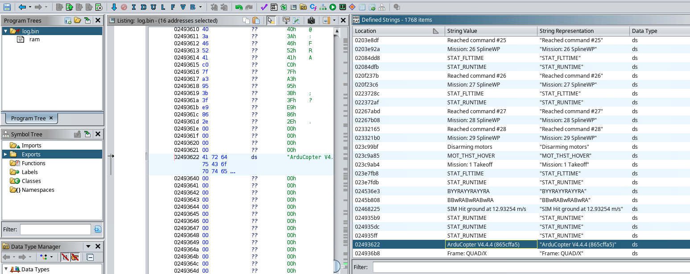
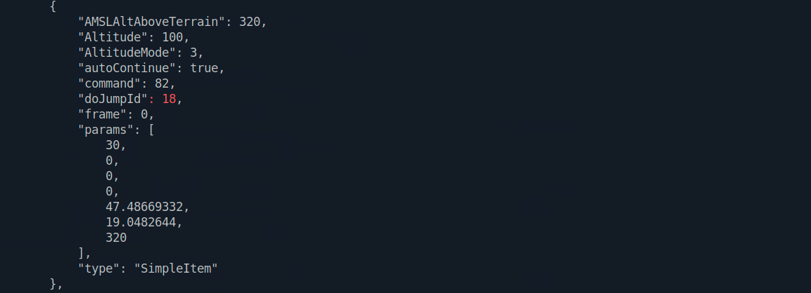
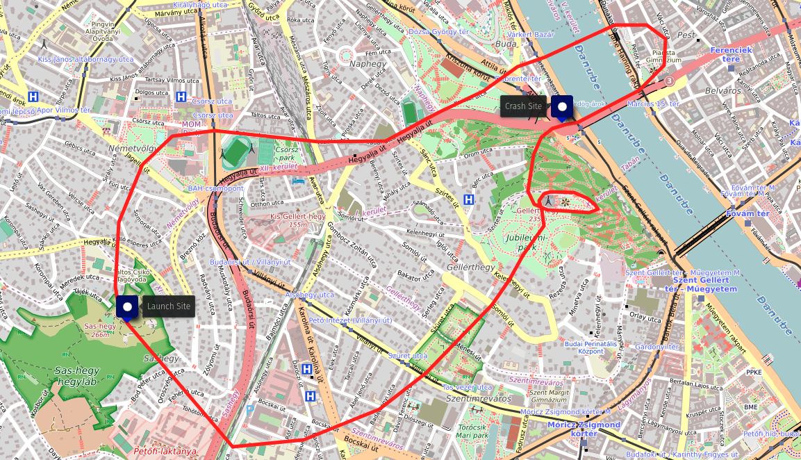
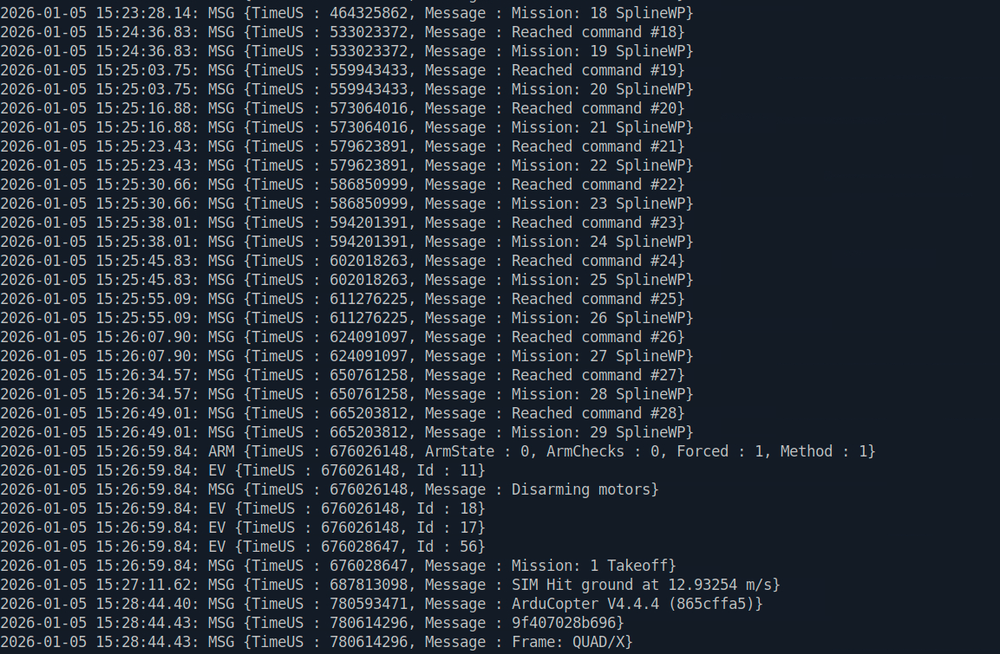

```markdown
# Advent of The Relics 4 — Drone Forensics Investigation

## Digital Forensics & Flight Telemetry Reconstruction Report

**Platform:** Hack The Box Sherlock  
**Campaign:** Advent of The Relics — Operation Winter Blackout  
**Investigation Type:** Digital Forensics / Drone Telemetry Analysis / Geospatial Reconstruction  
**Primary Evidence:** `log.bin`, `AOTR_Winter_Blackout.plan`  
**Classification:** Educational / Fictional Scenario  
**Overall Assessment Confidence:** High for directly observed telemetry and mission-plan findings

---

# Executive Summary

Part 4 of the Advent of the Relics investigation examined digital evidence recovered from a drone believed to be connected to **Operation Winter Blackout**.

The aircraft was recovered in Budapest after the Part 3 forensic investigation uncovered planning material describing drone-related activity. Its onboard telemetry and mission-plan file were provided for analysis to reconstruct the intended route, identify significant mission behavior, determine where the aircraft launched and crashed, and examine the terminal event recorded before impact.

Two primary evidence files were analyzed:

```text
log.bin
AOTR_Winter_Blackout.plan
```

Initial examination of `log.bin` in **Ghidra** exposed strings identifying the telemetry as originating from an **ArduCopter / ArduPilot-based quadcopter**, including:

```text
ArduCopter V4.4.4 (865cffa5)
Frame: QUAD/X
Mission: 1 Takeoff
Mission: 26 SplineWP
Disarming motors
SIM Hit ground at 12.93254 m/s
```

This identification led to the use of **ArduPilot pymavlink 2.4.50** and its `mavlogdump.py` utility to extract structured telemetry from the binary log.

The investigation established that:

- The planned mission routed the aircraft around **Citadella** in Budapest
- Mission item **18** contained a deliberate **30-second loiter**
- The planned route crossed the Danube near **Elisabeth Bridge**
- The recorded takeoff location was `47.4819399, 19.0191600`
- The recorded crash location was `47.4903055, 19.0460476`
- Total recorded flight duration from takeoff to impact was **00:10:38.919**
- The crash event occurred at `TimeUS 687813098`
- Ground-impact speed was recorded as **12.93254 m/s**
- Maximum recorded GPS altitude was **377.07 meters**
- Maximum recorded GPS ground speed was **10.24 m/s**

The mission-plan structure, telemetry, geographic evidence, and crash records strongly support the conclusion that the aircraft was operating as part of a deliberate preconfigured mission connected to Operation Winter Blackout.

The Part 4 findings also provide direct technical correlation with evidence recovered during Part 3, moving the investigation from adversary planning material into recorded execution by a physical system.

---

# Scenario Context

Evidence recovered during Part 3 revealed detailed planning tied to Operation Winter Blackout, including references to drone-assisted activity in Budapest.

Shortly after that disk was examined, investigators recovered a damaged, unmarked drone from a snowy area in the city. Its appearance and location were consistent with the operational material found earlier, making it a significant new evidence source.

The aircraft was brought in for forensic analysis together with two digital artifacts:

```text
log.bin
AOTR_Winter_Blackout.plan
```

The purpose of this examination was to determine how the drone had been programmed to fly, reconstruct its route from the available mission and telemetry data, identify notable mission behavior, establish where the flight began and ended, and analyze the final events leading up to the crash.

The results were then compared with findings from earlier phases of the investigation to determine whether the aircraft could be reliably associated with the same Winter Blackout operation.

> **Note:** This investigation is based on a fictional Hack The Box training scenario created for educational purposes.

---

# Scope

This examination was limited to the supplied drone-related digital evidence:

```text
log.bin
AOTR_Winter_Blackout.plan
```

No physical hardware acquisition, controller examination, radio-frequency capture, volatile-memory acquisition, or additional drone storage media was available.

The examination therefore focused on:

- Binary-file identification
- Mission-plan interpretation
- ArduPilot telemetry parsing
- GPS analysis
- Mission-event analysis
- Flight-path reconstruction
- Crash-event reconstruction
- Geospatial correlation
- Cross-investigation correlation

---

# Evidence Inventory

| Evidence | Type | Purpose |
|---|---|---|
| `log.bin` | ArduCopter telemetry log | Recorded flight telemetry and event reconstruction |
| `AOTR_Winter_Blackout.plan` | Drone mission-plan file | Programmed route, mission items, and loiter behavior |
| `output.json` | Derived analysis artifact | Structured telemetry extracted from `log.bin` |

---

# Evidence Integrity

SHA-256 hashes were calculated for both original evidence files before analysis.

| Evidence | Hash Type | Hash |
|---|---|---|
| `log.bin` | SHA-256 | `25923383a65808c5b2aadbc5b518724d2c15076125b557697b03d135b98026c3` |
| `AOTR_Winter_Blackout.plan` | SHA-256 | `5be349a60605408e59f5ae0da7ae3ae3a3949862fe3cbfb5d3a7b54fd52a4e2f` |

These hashes identify the exact telemetry and mission-plan artifacts used during the examination.

`output.json` was generated during analysis and treated as a derived working artifact rather than original evidence.

---

# Investigation Objectives

The examination sought to answer the following questions:

- What platform generated `log.bin`?
- What type of aircraft produced the telemetry?
- What route was programmed into the mission?
- Which geographic locations were significant to that route?
- Did the mission include a deliberate hold or loiter?
- Where did the aircraft take off?
- Where did it crash?
- How long was the recorded flight?
- What maximum speed and altitude were recorded?
- What telemetry was recorded at impact?
- How does the recovered drone evidence correlate with the Part 3 planning material?

---

# Tools Used

The investigation used:

- **Ghidra** — initial binary inspection and string analysis of `log.bin`
- **ArduPilot pymavlink 2.4.50** — structured ArduPilot telemetry parsing
- **`mavlogdump.py`** — extraction of selected telemetry message types
- **ArduPilot mission-format references** — interpretation of mission commands and waypoint behavior
- **Geospatial mapping tools** — visualization and geographic validation
- `sha256sum` — evidence integrity verification
- Standard Linux command-line utilities

---

# Forensic Workflow

```text
Evidence Received
      |
      +-------------------------------+
      |                               |
      v                               v
AOTR_Winter_Blackout.plan          log.bin
      |                               |
      v                               v
Mission Plan Analysis             Ghidra
      |                               |
      |                               v
      |                      ArduCopter Identified
      |                               |
      |                               v
      |                          pymavlink
      |                               |
      |                               v
      |                         mavlogdump.py
      |                               |
      |                               v
      |                          output.json
      |                               |
      +---------------+---------------+
                      |
                      v
             Flight Reconstruction
                      |
            +---------+---------+
            |                   |
            v                   v
      Mission Analysis      Crash Analysis
            |                   |
            +---------+---------+
                      |
                      v
            Geospatial Correlation
                      |
                      v
       Cross-Investigation Assessment
```

---

# Telemetry Format Identification

The recovered telemetry artifact was provided as:

```text
log.bin
```

Rather than assuming its format from the filename alone, I initially opened the binary in **Ghidra** and reviewed embedded strings.

Several strings strongly associated the evidence with the ArduPilot ecosystem:

```text
ArduCopter V4.4.4 (865cffa5)
Frame: QUAD/X
Mission: 1 Takeoff
Mission: 26 SplineWP
Mission: 27 SplineWP
Mission: 28 SplineWP
Mission: 29 SplineWP
Reached command #25
Reached command #26
Reached command #27
Reached command #28
Disarming motors
SIM Hit ground at 12.93254 m/s
```

### Source Evidence



*Figure 1: Ghidra string analysis of `log.bin` revealing ArduCopter version information, mission commands, vehicle-frame configuration, motor state, and impact-related telemetry.*

### Analysis

The firmware identifier:

```text
ArduCopter V4.4.4
```

strongly identified the telemetry as originating from an **ArduPilot-based multicopter**.

The additional frame identifier:

```text
QUAD/X
```

indicated an X-configuration quadcopter.

Mission-related strings also showed that the aircraft was executing a structured mission rather than simply recording unrestricted manual flight.

This evidence provided the basis for selecting ArduPilot-compatible tooling for further analysis.

**Confidence: High**

---

# Telemetry Parsing Methodology

After identifying `log.bin` as an ArduPilot/ArduCopter telemetry file, I used the `mavlogdump.py` utility included with `pymavlink 2.4.50` to extract selected message classes.

The command used was:

```bash
python3 ~/Downloads/pymavlink-2.4.50/tools/mavlogdump.py \
  --types EV,ERR,ARM,MSG,GPS \
  ~/Downloads/AOTR4/log.bin \
  > output.json
```

The selected telemetry types were:

| Message Type | Investigative Value |
|---|---|
| `EV` | Flight-event records |
| `ERR` | Error conditions |
| `ARM` | Aircraft arming state |
| `MSG` | Firmware and informational messages |
| `GPS` | Position, altitude, ground speed, and timing data |

The resulting parsed output was written to:

```text
output.json
```

This converted relevant portions of the binary telemetry into a more practical format for forensic review.

Values examined from the parsed telemetry included:

- GPS position
- GPS altitude
- Ground speed
- Event timing
- Arming state
- Firmware messages
- Mission activity
- Crash-related records

The original `log.bin` evidence remained unchanged throughout this process.

---

# Mission Plan Analysis

The recovered mission file:

```text
AOTR_Winter_Blackout.plan
```

contained a predefined flight plan through Budapest.

The mission contained multiple programmed waypoints and specific behavioral instructions rather than a simple point-to-point route.

## Citadella Route

Mission-plan analysis showed that the programmed route passed around:

```text
Citadella
```

in the Gellért Hill area of Budapest.

This provided a recognizable geographic reference for validating the mission route.

## Planned Loiter

Mission item:

```text
18
```

contained a programmed hold or loiter.

The configured duration was:

```text
30 seconds
```

### Assessment

The programmed pause indicates that the aircraft was intentionally expected to remain within a defined geographic area before continuing its mission.

Possible operational purposes could include:

- Observation
- Synchronization
- Position holding
- Sensor activity
- Waiting for an external event

The evidence confirms the programmed loiter but does not independently establish its intended operational purpose.

**Confidence: High for programmed behavior; purpose unconfirmed**

## Danube Crossing

The planned mission also crossed the Danube near:

```text
Elisabeth Bridge
```

This provided another geographic reference for validating the intended route through central Budapest.

---

# Mission Plan Findings

| Finding | Value |
|---|---|
| Significant landmark | `Citadella` |
| Loiter mission item | `18` |
| Planned loiter duration | `30 seconds` |
| Danube crossing | Near `Elisabeth Bridge` |

### Source Evidence



*Figure 2: Mission-plan evidence highlighting mission item 18 and its programmed 30-second loiter, with additional route context including Citadella and the Danube crossing near Elisabeth Bridge.*

---

# Flight Path Reconstruction

Using the recovered mission-plan data together with telemetry-derived launch and crash information, I reconstructed the geographic context of the drone's mission through Budapest.

The visualization shows:

- The recorded launch site at `47.4819399, 19.0191600`
- The programmed route through the Citadella / Gellért Hill area
- The route toward and across the Danube
- The recorded crash site at `47.4903055, 19.0460476`

### Source Evidence



*Figure 3: Geospatial reconstruction showing the programmed drone route together with the telemetry-derived launch and crash locations.*

### Analysis

The route structure is consistent with a deliberately configured mission rather than arbitrary movement.

The geographic relationship between the launch point, Citadella, river crossing, and final crash location provides a coherent reconstruction of the aircraft's operational environment.

The map should be interpreted as an analytical visualization based on the recovered mission plan and telemetry-derived locations, rather than as raw telemetry itself.

**Confidence: High**

---

# Flight Telemetry Summary

The parsed flight telemetry established the following key values:

| Finding | Value |
|---|---|
| Firmware | `ArduCopter V4.4.4` |
| Vehicle frame | `QUAD/X` |
| Takeoff coordinates | `47.4819399, 19.0191600` |
| Crash coordinates | `47.4903055, 19.0460476` |
| Total flight duration | `00:10:38.919` |
| Crash timestamp | `TimeUS 687813098` |
| Maximum GPS altitude | `377.07 m` |
| Maximum GPS ground speed | `10.24 m/s` |
| Ground-impact speed | `12.93254 m/s` |

The total recorded flight duration was approximately:

```text
638.919 seconds
```

The maximum recorded GPS ground speed of `10.24 m/s` is approximately:

```text
36.9 km/h
22.9 mph
```

The recorded impact speed of `12.93254 m/s` is approximately:

```text
46.6 km/h
28.9 mph
```

The altitude value represents GPS-reported altitude and should not automatically be interpreted as height above the local terrain.

### Source Evidence



*Figure 4: Telemetry evidence supporting the recorded takeoff and crash coordinates, flight duration, maximum altitude, maximum GPS ground speed, and terminal ground-impact event.*

---

# Crash Event and Pre-Impact Analysis

The telemetry identified the crash event at:

```text
TimeUS: 687813098
```

The recorded crash coordinates were:

```text
47.4903055, 19.0460476
```

A crash-related message recorded:

```text
SIM Hit ground at 12.93254 m/s
```

This directly supports the conclusion that a ground-impact event occurred.

The highest GPS ground speed recorded during the flight was:

```text
10.24 m/s
```

while the impact-related value was:

```text
12.93254 m/s
```

These values should not be interpreted as equivalent measurements.

GPS ground speed primarily reflects horizontal motion across the Earth's surface, while the impact-related value may represent a different component or combination of motion during the terminal phase.

### Assessment

The available evidence confirms that the aircraft experienced a substantial ground-impact event.

The reviewed telemetry does not, however, establish the exact mechanical, navigational, or control-system cause of the crash.

Additional telemetry that could strengthen root-cause analysis would include:

- Vertical speed
- Vehicle attitude
- Flight mode
- Motor output
- Battery state
- GPS health
- EKF status
- Failsafe events
- Navigation errors
- Pilot-control input

The impact itself is directly supported by the telemetry.

The mechanism that caused the aircraft to enter that terminal state remains unresolved from the evidence reviewed so far.

**Confidence: High for impact; crash cause undetermined**

---

# Flight Reconstruction Summary

The recovered evidence supports the following overall sequence:

```text
Takeoff
47.4819399, 19.0191600
       |
       v
Programmed Mission Begins
       |
       v
Citadella / Gellért Hill Area
       |
       v
Mission Item 18
30-Second Loiter
       |
       v
Danube Crossing
Near Elisabeth Bridge
       |
       v
Continued Mission Activity
       |
       v
Terminal Flight Event
       |
       v
Ground Impact
47.4903055, 19.0460476
       |
       v
Recorded Impact Speed
12.93254 m/s
```

---

# Cross-Investigation Correlation

Part 3 recovered operational documentation describing equipment and planning connected to Operation Winter Blackout.

The subsequent drone evidence aligns with several of those findings.

| Part 3 Evidence | Part 4 Evidence |
|---|---|
| Modified drone referenced in recovered documents | Drone evidence subsequently recovered |
| Budapest identified in operational planning | Mission and telemetry geographically located in Budapest |
| Structured operational planning | Predefined mission-plan file |
| Technical operational documentation | ArduCopter telemetry and mission commands |
| Winter Blackout campaign | `AOTR_Winter_Blackout.plan` |

### Assessment

The geographic, technical, and operational consistency between the recovered disk evidence and drone artifacts strongly supports the conclusion that both belong to the same broader operation.

Part 3 documented planning.

Part 4 documents evidence of aircraft configuration and execution.

That progression significantly strengthens the overall investigative reconstruction.

**Confidence: High**

---

# Evidence Relationships

```text
Part 3 Recovered Disk
        |
        v
Winter Blackout Planning Documents
        |
        v
Drone-Related Operational Planning
        |
        v
Recovered Drone Evidence
        |
        +--------------------------------+
        |                                |
        v                                v
AOTR_Winter_Blackout.plan             log.bin
        |                                |
        v                                v
Programmed Mission                 Ghidra Analysis
        |                                |
        v                                v
Waypoints / Loiter               ArduCopter Identified
        |                                |
        |                                v
        |                           pymavlink
        |                                |
        |                                v
        |                           output.json
        |                                |
        +---------------+----------------+
                        |
                        v
               Flight Reconstruction
                        |
              +---------+---------+
              |                   |
              v                   v
        Geospatial Analysis   Crash Analysis
              |                   |
              +---------+---------+
                        |
                        v
              Incident Reconstruction
```

---

# Indicators and Forensic Artifacts

| Type | Artifact | Significance |
|---|---|---|
| Telemetry | `log.bin` | Recorded flight telemetry |
| Mission Plan | `AOTR_Winter_Blackout.plan` | Programmed mission route |
| Derived Artifact | `output.json` | Structured telemetry extraction |
| Firmware | `ArduCopter V4.4.4` | Identifies ArduPilot ecosystem |
| Vehicle Frame | `QUAD/X` | X-configuration quadcopter |
| Landmark | `Citadella` | Significant mission-route reference |
| Mission Item | `18` | Programmed loiter |
| Loiter Duration | `30 seconds` | Planned position hold |
| Geographic Reference | `Elisabeth Bridge` | Danube crossing |
| Takeoff | `47.4819399, 19.0191600` | Recorded mission origin |
| Crash | `47.4903055, 19.0460476` | Recorded impact location |
| Crash Timestamp | `TimeUS 687813098` | Telemetry crash event |
| Impact Speed | `12.93254 m/s` | Recorded ground-impact velocity |
| Maximum GPS Altitude | `377.07 m` | Highest recorded GPS altitude |
| Maximum GPS Ground Speed | `10.24 m/s` | Highest recorded GPS ground speed |

---

# Investigative Implications

## Drone Telemetry as Forensic Evidence

Flight logs can preserve detailed historical information including:

- Geographic coordinates
- Altitude
- Speed
- Flight state
- Mission commands
- Arming events
- System messages
- Errors
- Crash events

This can allow investigators to reconstruct aircraft activity even when the physical drone has been damaged.

## Mission Intent and Actual Telemetry Should Be Separated

A mission-plan file represents **programmed intent**.

Telemetry represents **recorded aircraft activity**.

The two evidence sources should therefore be examined independently before being correlated.

Comparing them can reveal:

- Route deviations
- Unplanned pauses
- Unexpected altitude changes
- Navigation failures
- Manual intervention
- Failsafe activation
- Aborted mission stages

## Geographic Evidence Can Generate Physical Leads

Recovered coordinates may support additional investigative actions involving:

- Launch-site examination
- Crash-site examination
- CCTV acquisition
- Witness identification
- Controller searches
- Recovery of additional devices
- Local wireless investigation

---

# Analytical Limitations

## No Physical Hardware Examination

This analysis was performed using the supplied digital evidence.

The physical aircraft itself was not examined as part of this report.

As a result, no conclusions can be made regarding:

- Propeller condition
- Motor failure
- Battery damage
- Physical tampering
- Airframe damage
- Payload condition

## Mission Plan vs. Recorded Activity

The `.plan` file records programmed mission intent.

A programmed waypoint or loiter does not automatically prove that the aircraft successfully completed that instruction.

Where possible, mission-plan evidence should be validated against telemetry.

## Crash Cause

The telemetry confirms that a ground-impact event occurred.

The evidence reviewed so far does not establish the exact cause of the crash.

## Geospatial Reconstruction

The flight-path map is an analytical visualization created from mission-plan information and telemetry-derived locations.

It should not be interpreted as a screenshot of raw telemetry.

---

# Remaining Evidence Gaps

The following questions would be valuable for deeper analysis:

- What flight mode was active immediately before impact?
- Was the aircraft still executing the programmed mission when it crashed?
- Did actual GPS positions precisely follow the mission waypoints?
- Was there evidence of manual control?
- Were any failsafe conditions triggered?
- Did GPS quality degrade?
- Were any EKF navigation errors recorded?
- Was battery voltage abnormal?
- Did motor output change immediately before impact?
- What was the vertical descent rate?
- Did the programmed 30-second loiter execute for the expected duration?
- Was any payload or sensor-related activity recorded during the loiter?

These remain investigative questions rather than assumptions.

---

# Overall Assessment

The recovered drone evidence strongly supports an association with **Operation Winter Blackout**.

The digital evidence established:

- An ArduPilot-based quadcopter
- A predefined mission
- A deliberate route through Budapest
- Citadella as a significant route landmark
- A programmed 30-second loiter
- A planned Danube crossing near Elisabeth Bridge
- A specific recorded takeoff location
- Approximately 10 minutes and 39 seconds of flight activity
- A specific crash location
- A recorded high-speed ground-impact event

The strongest conclusion comes from the correlation of multiple independent evidence sources:

```text
Part 3 Operational Planning
          +
Recovered Mission Plan
          +
ArduCopter Telemetry
          +
GPS Evidence
          +
Mission Events
          +
Crash Telemetry
          =
Strong Operation Winter Blackout Association
```

The investigation demonstrates a progression from adversary planning and intelligence collection into physical-device digital forensics and telemetry-based incident reconstruction.

**Overall Confidence: High**

---

# Skills Demonstrated

- Digital Forensics
- Drone Forensics
- Binary File Analysis
- Ghidra
- ArduPilot Analysis
- pymavlink
- `mavlogdump.py`
- Telemetry Parsing
- Mission-Plan Analysis
- GPS Analysis
- Flight-Path Reconstruction
- Crash Reconstruction
- Geospatial Analysis
- Evidence Hashing
- Evidence Integrity Verification
- Derived Artifact Handling
- Timeline Reconstruction
- Cross-Source Correlation
- Cross-Investigation Analysis
- Analytical Reporting

---

# Appendix A — Evidence Hashes

```text
25923383a65808c5b2aadbc5b518724d2c15076125b557697b03d135b98026c3  log.bin

5be349a60605408e59f5ae0da7ae3ae3a3949862fe3cbfb5d3a7b54fd52a4e2f  AOTR_Winter_Blackout.plan
```

---

# Appendix B — Telemetry Extraction Command

```bash
python3 ~/Downloads/pymavlink-2.4.50/tools/mavlogdump.py \
  --types EV,ERR,ARM,MSG,GPS \
  ~/Downloads/AOTR4/log.bin \
  > output.json
```

---

# Evidence Images

```text
images/
├── ghidra-arducopter-identification.jpg
├── sherlock-flight-plan-findings.jpg
├── sherlock-crash-telemetry-findings.jpg
└── full-flight-reconstruction.jpg
```

---

# Previous Investigation

[Part 3 — Digital Forensics Investigation](../Part3-DigitalForensics/README.md)

---

# Disclaimer

This report documents a fictional Hack The Box Sherlock investigation created solely for educational and training purposes.

All threat actors, organizations, operational activity, aircraft, and events described as part of the scenario are fictional.

Real geographic locations referenced by the training data are discussed only as part of analysis of the provided fictional evidence.

The report documents my investigative methodology, evidence handling, binary analysis, telemetry parsing, geospatial reconstruction, findings, and analytical conclusions.
```
